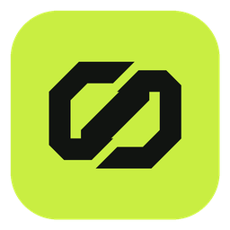

# CadreLink

Phone cameras for Windows. Android becomes a webcam over your local network. iPhone sends video from Safari into OBS through an assisted VDO.Ninja setup.

[Download the Windows setup](https://github.com/depre99ed/CadreLink/releases/latest)

| Phone | How it connects | Where the image goes |
|---|---|---|
| Android 11 or later | QR pairing over Wi-Fi, Ethernet or USB tethering | CadreLink virtual camera in OBS or Discord, or a clean capture window |
| iPhone | Safari, using a QR link to VDO.Ninja | OBS Browser Source, ready for overlays and scenes |

Windows 11 x64 is required for the studio and virtual camera. The Windows setup is unsigned. It contains the signed Android APK.

## Installation et connexion

### Android

1. Ouvre `CadreLink-setup.exe`. La demande administrateur sert à enregistrer la caméra Windows et la règle de pare-feu du réseau local.
2. Dans le studio, clique sur **Associer**. **Installer ou mettre à jour Android** affiche un code pour télécharger l’APK depuis le PC.
3. Repasse au QR d’association. Scanne-le dans CadreLink sur le téléphone et autorise la caméra.
4. Dans OBS, ajoute un **Périphérique de capture vidéo** et choisis **CadreLink (Windows Virtual Camera)**. Dans Discord, sélectionne la caméra CadreLink et le micro de ton casque dans **Voix et vidéo**.

Pour brancher un Samsung, utilise un câble de données et active **Paramètres → Connexions → Point d’accès mobile et modem → Modem USB**. Dans **Associer**, choisis **USB · partage de connexion**, actualise la liste et scanne le QR affiché. Une fois les deux liaisons associées au même PC, Android peut essayer l’autre si la connexion coupe. Le modem USB peut aussi partager l’accès Internet du téléphone avec Windows.

CadreLink et l’ancienne installation Focale utilisent le même port. Ferme Focale avant de lancer CadreLink. Si tu passes définitivement à CadreLink, Windows peut désinstaller Focale séparément. L’association Android, les profils et les réglages de Focale restent accessibles. L’APK utilise le même identifiant et, pour les versions officielles publiées ici, la même clé de signature.

### iPhone sans appli

1. Sur le PC, ouvre **iPhone et OBS** dans CadreLink. Ajuste la qualité souhaitée et le micro avant de scanner.
2. Avec l’appareil photo de l’iPhone, scanne le QR. Dans Safari, autorise la caméra et démarre le direct. Garde l’onglet ouvert au premier plan.
3. Dans le studio, clique sur **Copier le lien OBS**. Dans OBS, ajoute une source **Navigateur**, colle le lien dans **URL** et choisis une taille de 1920 × 1080 ou 1280 × 720 à 30 i/s. Ajoute tes overlays par-dessus dans la scène OBS.

Les deux liens sont mémorisés sur ce PC. Traite-les comme des liens privés. Le bouton **Renouveler les liens** prépare une nouvelle session. Arrête l’ancienne dans Safari, rescanne le QR et remplace l’URL dans OBS.

Safari → OBS utilise le service tiers VDO.Ninja et nécessite Internet. OBS reçoit le flux WebRTC de l’iPhone directement via sa source Navigateur. Le cadrage local de CadreLink et ses commandes Android s’appliquent au flux Android. La qualité iPhone dépend du téléphone, de Safari et de la connexion. [Démarrage VDO.Ninja](https://docs.vdo.ninja/getting-started) · [Particularités iOS](https://docs.vdo.ninja/platform-specific-issues/ios)

## Le studio

- **Cadrage automatique local**. Suis la personne entière, le buste ou le visage. Le suivi du corps utilise les épaules, le tronc et les membres visibles. Il élargit le cadre quand la personne sort du champ. Le modèle travaille sur le PC.
- **Réglages caméra**. Objectif, zoom, rotation, exposition, rendu naturel et modes 1080p jusqu’à 60 i/s ou 4K jusqu’à 30 i/s selon l’appareil. Les commandes disponibles dépendent du capteur Android.
- **Profils et mini-fenêtre**. Mémorise trois placements, rappelle-les en un clic et garde la mini-fenêtre visible au-dessus d’OBS ou de Discord.
- **Confidentialité**. `Ctrl+P` masque la webcam Windows et la sortie propre, tout en laissant l’aperçu local. Pour arrêter l’iPhone, termine le direct dans Safari.
- **Sortie propre et photo**. Capture la fenêtre dédiée dans OBS si nécessaire. `Ctrl+S` enregistre en PNG une image de la sortie jusqu’à 3840 × 2160. `F11` agrandit l’aperçu.
- **Signal**. Consulte les images décodées par seconde, le débit reçu, la batterie et le délai aller-retour avec le téléphone. Ce délai mesure la liaison et ne correspond pas à la latence totale dans OBS.

Les raccourcis globaux doivent être activés dans **Profils**. `Ctrl+Alt+1–3` rappelle un profil, `Ctrl+Alt+F9` masque ou rétablit la sortie et `Ctrl+Alt+F10` ouvre ou ferme la mini-fenêtre.

Si la caméra manque dans OBS ou Discord, relance l’application et vérifie l’accès des applications de bureau à la caméra dans les paramètres Windows. Sur OBS, la fenêtre **Sortie propre** fonctionne aussi avec **Capture de fenêtre**.

## Build

`scripts\build.ps1` produit le setup NSIS et l’APK. Prérequis Windows : Visual Studio avec C++ x64 et SDK Windows 10.0.26100, SDK .NET 8 Desktop, JDK 17 ou 21, SDK Android plateforme 36 et build-tools 37.0.0, NSIS 3.11 ou plus récent. Définis `ANDROID_HOME` et passe `-NsisCompiler` si `makensis.exe` est hors du PATH.

Le script vérifie le modèle MoveNet et le module officiel Tauri avant de les empaqueter. La clé de signature Android est conservée dans le profil du compte de build, hors du dépôt. Les installations existent sans ces outils de build. Les notices des composants distribués se trouvent dans [NOTICE.txt](NOTICE.txt).
